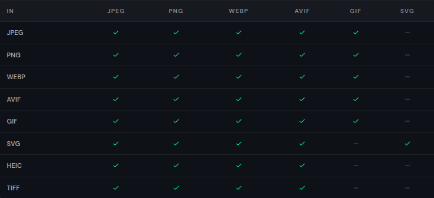

<div align="center">


<br/>

### A better way to optimize images.

**Compress. Convert. Compare.**

<br/>

<a href="https://pixiora.netlify.app">
  
</a>
<a href="https://github.com/ar0x1/pixiora">
  
</a>

<br/><br/>


<br/>


</div>

---

## The idea behind PIXIORA

Images should be easy to optimize. Privacy shouldn't be a trade-off.

**PIXIORA** is a browser-based image compressor and converter built around one principle: your files should never need to leave your device just to be optimized.

Powered by WebAssembly and Web Workers, PIXIORA brings image processing directly to your browser — without a processing backend, accounts, API keys, or image uploads.

No unnecessary complexity. Just your image and the tools to optimize it.

## Supported formats

PIXIORA supports a range of image formats, with conversion availability depending on the source, destination and browser capabilities.



## Built around privacy

| Privacy property | Implementation |
|:--|:--|
| Image processing | Browser-local |
| Image uploads | None |
| Processing backend | None |
| Accounts | Not required |
| API keys | Not required |
| Analytics | None |
| Cookies | None |
| Image persistence | None |
| Preferences | Local browser storage |

## Limitations

| Resource | Limit |
|:--|--:|
| Maximum file size | 250 MB |
| Maximum image pixels | 150 MP |
| Maximum dimension | 16,384 px |
| Compression quality | 50 (fixed) |
| Encoder effort | 6 (fixed) |
| Concurrent worker pool | Up to 4 |

## Technology

<div align="center">


</div>

| Technology | Purpose |
|:--|:--|
| React 19 | Interface |
| TypeScript | Application logic |
| Vite | Development and production builds |
| Tailwind CSS 4 | Styling |
| Zustand | State management |
| WebAssembly | Image codecs |
| Web Workers | Background processing |
| Vitest | Unit and component testing |
| Playwright | Browser and end-to-end testing |
| axe-core | Accessibility testing |

### Image processing codecs

- MozJPEG
- Squoosh PNG / OxiPNG
- libwebp
- libavif
- gifenc
- gifuct-js
- SVGO
- libheif
- UTIF

## Run PIXIORA locally

Want to explore the code or run your own instance?

### Requirements

- Node.js 20 LTS or newer
- npm 10+

### Installation

```bash
# Clone PIXIORA
git clone https://github.com/ar0x1/pixiora.git

# Navigate into the project
cd pixiora

# Install dependencies
npm install --legacy-peer-deps

# Start development
npm run dev
```

Open your browser at:

```text
http://localhost:5173
```

**No environment file, API key, database or backend server is require**.


## Project structure

```text
pixiora/
│
├── public/
│   ├── fonts/
│   ├── icons/
│   └── ...
│
├── src/
│   ├── app/              # Application and routing
│   ├── components/       # Interface components
│   ├── engine/           # Image processing engine
│   │   ├── codecs/
│   │   ├── core/
│   │   ├── workers/
│   │   └── optimization/
│   ├── hooks/            # Application hooks
│   ├── store/            # State management
│   ├── styles/           # Design tokens and animations
│   ├── utils/            # Shared utilities
│   └── types/            # TypeScript definitions
│
├── scripts/
├── tests/
│   ├── unit/
│   ├── components/
│   └── e2e/
│
├── docs/
│   └── design-system/
│
├── index.html
├── package.json
├── vite.config.ts
└── README.md
```
---
## Connect

Found something interesting? Have an idea or spotted an issue?

<p> 
  <a href="mailto:killtoneizuku@gmail.com">
   
  </a>
</p>

<p> <align="center">
  OR
</align="centre">
</p>

  - **Issues & feedback:** [GitHub Issues](https://github.com/ar0x1/pixiora/issues)

---

<div align="center">


### PIXIORA


**Designed & developed by [ar0x](https://github.com/ar0x1)**

<sub>Do Not Compliment.</sub>

</div>
